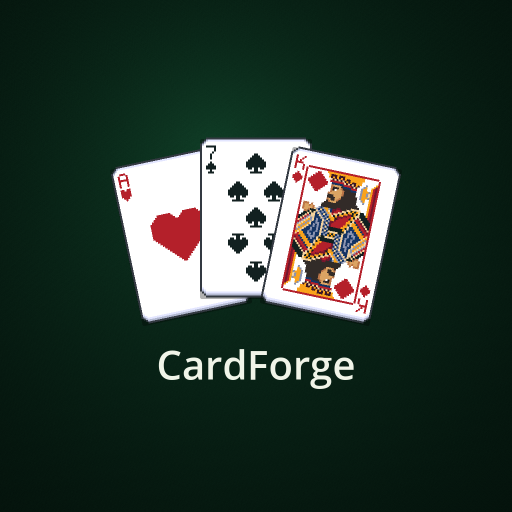

# 🃏 CardForge

**Карточные игры, друзья и немного инженерной магии.**

Игра и расширяемая платформа карточных режимов на **Godot**, созданная [PilotOfAsuka](https://github.com/PilotOfAsuka) при поддержке Codex.

### [🌐 Играть в браузере](https://pilotofasuka.github.io/AsukasGame/) · [📱 Скачать APK](https://github.com/PilotOfAsuka/AsukasGame/releases/latest)

---

## 🎮 Что такое CardForge?

**CardForge** — развивающийся проект с несколькими карточными играми, одиночными режимами и возможностью играть с друзьями.

Сейчас доступны, в частности:

- **«Тысяча»** — игра на троих с торгами, прикупом, марьяжами и бочкой.
- **SIX** — карточный режим с персональными стопками игроков.
- **Блэкджек** — игра с общим дилером и отдельным результатом для каждого участника.

В разных режимах доступны игра с ботами, локальная сеть и комнаты через интернет. Поддержка конкретного числа игроков и правил зависит от выбранной игры.

## 🚀 Как начать

| Платформа | Как запустить |
| :--- | :--- |
| 🌐 **Web** | Откройте [CardForge в браузере](https://pilotofasuka.github.io/AsukasGame/) — устанавливать APK не нужно. |
| 🤖 **Android** | Перейдите в [последний релиз](https://github.com/PilotOfAsuka/AsukasGame/releases/latest) и скачайте файл `CardForge-*.apk`. |
| 📱 **iPhone / iPad** | Откройте веб-версию в браузере; при поддержке браузера её можно добавить на экран «Домой». |

> **Для сетевой игры** всем участникам рекомендуется использовать одну актуальную версию. Интернет-комнаты зависят от доступности внешнего игрового сервера.

### 📦 Последний опубликованный релиз

**CardForge 0.14.0** — SIX и блэкджек получили мультиплеер по локальной сети и через интернет на **2–6 участников**; незанятые места могут занимать боты.

[📄 Подробности релиза 0.14.0](https://github.com/PilotOfAsuka/AsukasGame/releases/tag/v0.14.0) · [📚 История изменений](CHANGELOG.md)

## 🗂️ Что хранится в этом репозитории

Это **репозиторий публикации CardForge**, а не полный исходный проект Godot:

- `index.html`, `index.js`, `index.wasm`, `index.pck` и сопутствующие файлы — готовая **веб-сборка** для GitHub Pages;
- `index.manifest.json`, иконки и service worker — файлы веб-приложения;
- `version.json` — информация о текущей версии, используемая при публикации;
- **[Releases](https://github.com/PilotOfAsuka/AsukasGame/releases)** — версии игры и установочные APK для Android.

Здесь **не размещаются исходные сцены, скрипты и ресурсы проекта Godot**. Название репозитория `AsukasGame` сохранено ради совместимости с существующим адресом игры.

## 🛠️ Технологии

`Godot` · `GDScript` · `HTML5 / WebAssembly` · `WebSocket` · `Android`

## 🔄 Разработка и обновления

CardForge находится в активной разработке: улучшаются карточные механики, интерфейс, архитектура и сетевые режимы.

- [📝 История версий](CHANGELOG.md)
- [📦 Порядок публикации веб-сборки и APK](docs/PUBLISHING.md)
- [🐛 Сообщить о проблеме или предложить идею](https://github.com/PilotOfAsuka/AsukasGame/issues)

---

**Сделано с интересом к играм, инженерным подходом и помощью Codex.** 😄

*PilotOfAsuka · CardForge*

